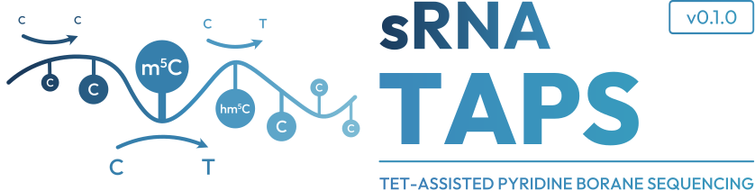

<p align="center">
  
</p>
<p align="center"><strong>TAPS-based m5C and hm5C detection pipeline for small RNA sequencing</strong></p>

<p align="center">
  
  
  
  
  
  <a href="https://github.com/HenzelerB/sRNA-TAPS/actions/workflows/ci.yml"></a>
  <a href="https://github.com/HenzelerB/sRNA-TAPS/releases/tag/v0.1.0"></a>
</p>

<p align="center">
sRNA-TAPS detects 5-methylcytosine (m5C) and 5-hydroxymethylcytosine (hm5C) in small RNA using TET-assisted pyridine borane sequencing (TAPS). It covers miRNA, tRNA, rRNA, snoRNA, snRNA, piRNA, and lncRNA biotypes. Human (GRCh38) was used for validation, and other species are supported through Ensembl references. The method was developed from DNA TAPS (Liu et al., <em>Nature Biotechnology</em> 2019) for biological RNA without synthetic spike-in controls.
</p>

---

## 📋 Table of Contents

<ol>
  <li><a href="#-chemistry">Chemistry</a></li>
  <li><a href="#-experimental-design">Experimental Design</a></li>
  <li><a href="#️-installation">Installation</a></li>
  <li><a href="#-quick-start">Quick Start</a></li>
  <li><a href="#-test-dataset">Test Dataset</a></li>
  <li><a href="#-validation">Validation</a></li>
  <li><a href="#-m5c-atlas">m5C Atlas</a></li>
  <li><a href="#-data-availability">Data Availability</a></li>
  <li><a href="#-usage">Usage</a></li>
  <li><a href="#-pipeline-overview">Pipeline Overview</a></li>
  <li><a href="#-pipeline-steps-in-detail">Pipeline Steps in Detail</a></li>
  <li><a href="#-the-delta-δ-score">The Delta (δ) Score</a></li>
  <li><a href="#️-snp-filtering">SNP Filtering</a></li>
  <li><a href="#-output">Output</a></li>
  <li><a href="#-requirements">Requirements</a></li>
  <li><a href="#-citation">Citation</a></li>
  <li><a href="#️-license">License</a></li>
  <li><a href="#️-affiliation">Affiliation</a></li>
</ol>

---

## 🧪 Chemistry

TAPS works through two sequential reactions: TET enzymes oxidise m5C and hm5C to 5-formylcytosine (f5C) and 5-carboxylcytosine (ca5C), which pyridine borane then reduces to dihydrouracil (DHU). DHU is read as T during PCR. Unmodified cytosines pass through the chemistry unchanged, so the readout is the opposite of bisulfite sequencing: a C→T transition marks a modified base rather than an unmodified one.

#### Why TAPS for small RNA?

Bisulfite treatment degrades short RNA molecules and converts ~99% of unmodified cytosines, making short reads difficult to align. sRNA-TAPS uses a three-letter Bowtie1 strategy: reads and references are converted for alignment, both genomic strands are searched independently, and the original read sequence and qualities are restored before C-to-T calling. This prevents genuine TAPS conversions from consuming the mismatch budget.

#### Why not use lambda phage spike-ins?

Lambda spike-ins calibrate conversion efficiency for double-stranded DNA. TET enzymes act differently on RNA, and the adapter ligation and reverse transcription steps in small RNA library preparation do not process DNA spike-ins the same way. sRNA-TAPS uses matched untreated and PB-only controls at each position instead, with known mitochondrial tRNA m5C sites as internal positive controls.

---

## 🔬 Experimental Design

Three conditions are required:

| Condition | Treatment | Purpose |
|-----------|-----------|---------|
| `treat` | TET oxidation + pyridine borane | Full TAPS — detects m5C and hm5C |
| `pb_Ctrl` | Pyridine borane only (no TET) | Measures PB-associated background conversion |
| `no-treat` | No chemistry | Significance baseline, sequencing error and SNP filtering |

Sites are called against the untreated control, which gives a conversion baseline free of PB-associated background. The `pb_Ctrl` condition is not a pass/fail gate. It is tested in the same way to quantify PB-associated background, and that difference is subtracted to report a background-corrected modification level.

---

## ⚙️ Installation

#### From source

```bash
git clone https://github.com/HenzelerB/sRNA-TAPS
cd sRNA-TAPS
git checkout v0.1.0
python -m pip install -e .
```

#### From PyPI

```bash
python -m pip install sRNA-TAPS
```

The PyPI package `0.1.0.post1` is the same code as the `v0.1.0` tag. Its version number differs because PyPI does not allow a file name to be reused. Pipeline tools such as Bowtie and samtools are installed separately, for example with the full environment below.

#### Full environment

```bash
conda env create -f environment.yaml
conda activate sRNA-TAPS
python -m pip install -e . --no-deps
```

#### R packages (for report figures)

Required for publication-ready figure generation. Report figures are generated automatically as part of the pipeline, but R packages must be installed first.

```bash
Rscript install_R_packages.R
```

---

## 🚀 Quick Start

sRNA-TAPS runs as a Snakemake 9 profile-based workflow. All SLURM resource allocation is handled by the profile — no manual cluster submission strings needed.

```bash
# 1. Create a project with a complete config.yaml and a samples.tsv template
srnataps init --outdir ~/my_taps_project --species human --fastq-dir /path/to/fastq
cd ~/my_taps_project

# 2. Set the paths marked <REQUIRED> in config.yaml

# 3. List your samples in samples.tsv (see Usage section)

# 4. Run the full pipeline
bash /path/to/sRNA-TAPS/sRNA_taps.bash

#    — or directly with Snakemake —
snakemake \
    --snakefile /path/to/sRNA-TAPS/srnataps/workflow/Snakefile \
    --configfile config.yaml \
    --profile    /path/to/sRNA-TAPS/srnataps/workflow/profiles/slurm

# 5. Run with benchmarking (optional — slow, manuscript-only)
snakemake \
    --snakefile /path/to/sRNA-TAPS/srnataps/workflow/Snakefile \
    --configfile config.yaml \
    --profile    /path/to/sRNA-TAPS/srnataps/workflow/profiles/slurm \
    all_benchmark
```

The pipeline automatically downloads the selected species reference from Ensembl and builds the Bowtie1 and three-letter indexes when they are not already present. Report figures are generated at each stage without additional indexing steps.

---

## 🧬 Test Dataset

`tests/simulate_taps_srna.py` writes a small synthetic dataset for checking an installation: 100 HEK samples (34 `treat`, 33 `pb_Ctrl`, 33 `no-treat`) and a matching `samples.tsv`.

```bash
python3 tests/simulate_taps_srna.py --outdir ~/srnataps_sim --reads 1000000 --seed 42
```

The manuscript benchmark uses a separate ground-truth set, [`benchmark/fig2c_truth_set.tsv`](benchmark/fig2c_truth_set.tsv) (see [`benchmark/README.md`](benchmark/README.md)). Its generated FASTQ and alignment files are not bundled because they are large, but [`benchmark/simulation/`](benchmark/simulation/) rebuilds the truth table and reads.

For any simulator that emits the same `truth.tsv` coordinate schema, evaluate pipeline calls with:

```bash
srnataps evaluate \
    --truth truth.tsv \
    --calls-dir 07d.replicate_calls \
    --samples-tsv samples.tsv \
    --outdir 10.truth_evaluation \
    --condition treat
```

Truth-based evaluation is for synthetic validation only. It is not used by the caller and must not be used to tune thresholds on biological experiments.

---

## ✅ Validation

The manuscript benchmark planted 738 sites at known rates in simulated small RNA libraries. 100 discovery sites carried signal only under TET + PB. 638 shared sites also carried a correlated PB-only signal at 5 to 15% of the treatment rate.

| Tool | Discovery recovery | Shared recovery | RMSE |
|------|--------------------|-----------------|------|
| sRNA-TAPS | 98% | 99% | ≈ 0.05 |
| Bismark | 81% | 81% | ≈ 0.48 to 0.49 |
| asTair | 69 to 72% across batches | | ≈ 0.12 to 0.14 |
| rastair | 5 to 8% across batches | | ≈ 0.02 to 0.03 |

Recovery is the fraction of truth sites with a reported rate at coverage of at least 5. RMSE is computed on recovered sites. These figures describe a planted simulation and are not performance guarantees for biological samples, which depend on library complexity, RNA abundance, chemistry quality and multimapping.

---

## 🗺️ m5C Atlas

The [m5C Atlas](https://henzelerb.github.io/sRNA-TAPS/m5c-atlas.html) lists the final 2,416 sites from Caco-2 and HEK293T (610 miRNA, 135 mitochondrial tRNA, 358 rRNA, 1,313 snoRNA), with sequence, structure and literature support. A further 321 miRNA sites are labelled as the Figs. 4 to 6 set. These are in mature arms and meet a per-site rule but not the final criteria.

---

## 💾 Data Availability

Sequencing data are available from GEO under accession [GSE350670](https://www.ncbi.nlm.nih.gov/geo/query/acc.cgi?acc=GSE350670). The benchmark truth set and the scripts to rebuild it are in [`benchmark/`](benchmark/).

---

## 📖 Usage

### Project directory structure

Every sRNA-TAPS run needs a project directory containing two files:

```
my_project/
├── config.yaml      # pipeline configuration
├── samples.tsv      # sample sheet
└── rawfiles/        # input FASTQs (*.fq.gz)
```

### config.yaml

Create the project with `srnataps init`. It writes a complete `config.yaml` containing every required section. Set the paths marked `<REQUIRED>` and keep the other defaults unless you have a reason to change them.

```bash
srnataps init --outdir my_project --species human --fastq-dir /data/fastq
```

The settings most often changed are:

```yaml
reference:
  species: human          # see supported values below
  ensembl_release: 112
  dbsnp_vcf: ""           # optional, leave empty to skip the dbSNP layer

condition_analysis:
  test_min_coverage: 5
  minimum_replicates: 3
  minimum_delta: 0.10
  replicate_test: "bayesian"       # bayesian, beta_binomial, or mannwhitney
  primary_control: "no_treat"      # PB stays a background measurement
  minimum_posterior_probability: 0.95
  stringent_max_padj: 1.0e-20
```

> **Reference auto-download:** Choose `reference.species` and leave `genome_fa`, `gtf`, and `bowtie1_index` blank. The pipeline derives the Ensembl filenames, downloads the unmasked `dna.toplevel` FASTA and GTF for the configured release, and builds all indexes. Explicit paths override these defaults.

List supported species and assemblies with:

```bash
srnataps species
```

| Configuration name | Species | Assembly |
|--------------------|---------|----------|
| `human` | *Homo sapiens* | GRCh38 |
| `mouse` | *Mus musculus* | GRCm39 |
| `rat` | *Rattus norvegicus* | mRatBN7.2 |
| `zebrafish` | *Danio rerio* | GRCz11 |
| `fruit_fly` | *Drosophila melanogaster* | BDGP6.46 |
| `c_elegans` | *Caenorhabditis elegans* | WBcel235 |
| `chicken` | *Gallus gallus* | bGalGal1.mat.broiler.GRCg7b |

For example:

```bash
srnataps init --outdir mouse_taps --species mouse --fastq-dir /data/fastq
```

For an organism or assembly outside the registry, provide your own matching FASTA and GTF:

```bash
srnataps init --outdir custom_taps \
  --genome /refs/custom.fa --gtf /refs/custom.gtf
```

### samples.tsv

Tab-separated, one row per sample. Four columns are required:

| Column | Description |
|--------|-------------|
| `sample` | Unique sample identifier — used for all output filenames |
| `condition` | One of the three conditions. Common labels are recognised, such as `treat`, `pb_Ctrl`, `no-treat` and `no_treat`, and a label that cannot be recognised stops the run |
| `cell_line` | Cell line or biological source — any name; used to group SNP blacklists and colour palettes |
| `fastq` | Full path to the input `.fq.gz` file (single-end) |

Example with two cell lines, three conditions, three replicates each:

```
sample                  condition  cell_line  fastq
no-treat_Ctrl_HEK_R1    no-treat   HEK        /data/rawfiles/no-treat_Ctrl_HEK_R1.fq.gz
no-treat_Ctrl_HEK_R2    no-treat   HEK        /data/rawfiles/no-treat_Ctrl_HEK_R2.fq.gz
no-treat_Ctrl_HEK_R3    no-treat   HEK        /data/rawfiles/no-treat_Ctrl_HEK_R3.fq.gz
pb_Ctrl_HEK_R1          pb_Ctrl    HEK        /data/rawfiles/pb_Ctrl_HEK_R1.fq.gz
pb_Ctrl_HEK_R2          pb_Ctrl    HEK        /data/rawfiles/pb_Ctrl_HEK_R2.fq.gz
pb_Ctrl_HEK_R3          pb_Ctrl    HEK        /data/rawfiles/pb_Ctrl_HEK_R3.fq.gz
treat_HEK_R1            treat      HEK        /data/rawfiles/treat_HEK_R1.fq.gz
treat_HEK_R2            treat      HEK        /data/rawfiles/treat_HEK_R2.fq.gz
treat_HEK_R3            treat      HEK        /data/rawfiles/treat_HEK_R3.fq.gz
no-treat_Ctrl_Caco2_R1  no-treat   Caco2      /data/rawfiles/no-treat_Ctrl_Caco2_R1.fq.gz
...                     ...        ...        ...
```

> **Minimum requirement:** At least 3 replicates per condition are needed for reproducibility filtering. Cell line names can be anything. Condition labels must map to one of the three conditions. Multi-cell-line datasets are fully supported.

### Running the pipeline

**Option 1 — tmux launcher (recommended for SLURM clusters):**

```bash
cd /path/to/my_project
bash /path/to/sRNA-TAPS/sRNA_taps.bash
# Attach to the session: tmux attach -t sRNA_TAPS
# Detach without stopping: Ctrl+B then D
```

**Option 2 — direct Snakemake (background):**

```bash
cd /path/to/my_project
snakemake \
    --snakefile /path/to/sRNA-TAPS/srnataps/workflow/Snakefile \
    --configfile config.yaml \
    --profile    /path/to/sRNA-TAPS/srnataps/workflow/profiles/slurm &
```

**Dry-run first (always recommended):**

```bash
snakemake \
    --snakefile /path/to/sRNA-TAPS/srnataps/workflow/Snakefile \
    --configfile config.yaml \
    --profile    /path/to/sRNA-TAPS/srnataps/workflow/profiles/slurm \
    --dry-run
```

**Benchmarking (opt-in):**

```bash
snakemake \
    --snakefile /path/to/sRNA-TAPS/srnataps/workflow/Snakefile \
    --configfile config.yaml \
    --profile    /path/to/sRNA-TAPS/srnataps/workflow/profiles/slurm \
    all_benchmark
```

**Condition-level evidence analysis:**

```bash
srnataps module condition --configfile config.yaml --slurm
```

This module pools matched `treat`, `pb_ctrl`, and `no_treat` samples by cell
line, runs the replicate-level Bayesian model, and writes both discovery and
configurable stringent evidence tiers.

### Monitoring

```bash
# Check running SLURM jobs
squeue -u $USER

# Watch Snakemake log
tail -f .snakemake/log/$(ls -t .snakemake/log/ | head -1)
```

---

## 🔄 Pipeline Overview

```
rawfiles/           Raw FASTQs (SE, TruSeq small RNA)
    ↓
    [Genome setup — runs once per genome, skipped if files exist]
    download_genome   Download GRCh38 FASTA from Ensembl
    download_gtf      Download GRCh38 GTF from Ensembl
    index_genome_fa   samtools faidx
    bowtie1_index     Build Bowtie1 index
    ↓
01. FastQC (pre-trim)   QC on raw reads
02. Trim Galore         TruSeq SR adapter trimming (--small_rna)
03. FastQC (post-trim)  QC on trimmed reads
04. Three-letter Bowtie1 C-to-T/G-to-A alignment; original sequences restored
05. Biotype split       miRNA > tRNA > piRNA > snoRNA > snRNA > rRNA > lncRNA > other
06. SNP filter          3-layer: cell-line-specific + heterozygosity [+ dbSNP]
07. TAPS calling        Strand-aware C/T counting and per-sample calls
07a. Sample-profile QC  UMAP/PCA of per-sample modification profiles
07b. Pool conditions    Pool counts within condition and cell line
07c. Control contrast   Pooled Fisher tests against PB-only and no-treatment
07d. Replicate calls    Bayesian replicate model gated on no-treatment
07e. Stringent calls    Configurable q-value, effect, and depth tier
    ↓
    [Reports — generated automatically after each stage]
    report_qc           Read length distribution, mapping rates
    report_biotype      Biotype composition
    report_modification Modification rates, top sites, condition comparison,
                        waterfall, trinucleotide context
    report_seqlogos     Sequence logos (±5 and ±10 nt, per biotype)
    report_mirna_atlas  Mature miRNA modification atlas
    report_global_distribution  Global modification rate distribution
    multiqc             Aggregated QC HTML report
    ↓
    [Benchmarking — opt-in via `all_benchmark` target]
08. Benchmark*      rastair (CpG + all-context) · asTair (biotype BAMs) · Bismark
09. Compare*        Concordance · Pearson/Spearman correlation
    report_benchmark  Concordance heatmap, correlation, site overlap (opt-in)
```

`*` requires `all_benchmark` target

---

## 🔍 Pipeline Steps in Detail

### Stage 07a: Sample-profile QC

Stage 07a is an early QC checkpoint that uses the unfiltered, per-sample calls
from stage 07. It embeds modification-rate profiles across biotypes before
pooling or differential filtering, allowing sample relationships and unusual
replicates to be inspected without downstream selection effects.

The default three-condition figure encodes `PB- TET-`, `PB+ TET-`, and
`PB+ TET+` using the Aurora palette. Cell line is encoded by point shape.
Cluster membership, nearest neighbours, outliers, and statistics are written as
separate machine-readable outputs rather than overloaded onto the figure.

For the direct `PB+ TET-` versus `PB+ TET+` comparison, use the focused PCA
analysis. PCA is deterministic and labels axes with explained variance, making
it preferable to a nonlinear embedding for this two-group comparison. A
four-of-six replicate sensitivity analysis may retain the four profiles closest
to each condition-by-cell-line centroid; it is a QC sensitivity analysis only
and must not replace the prespecified six-replicate primary analysis.

### Genome Setup
**Tools:** wget, samtools faidx, bowtie-build

If the genome FASTA or GTF do not exist at the paths specified in `config.yaml`, the pipeline downloads them automatically from the Ensembl FTP server (release set by `ensembl_release` in config). The unmasked `dna.toplevel` FASTA is used — the repeat-masked version soft-masks cytosines, which would suppress genuine C→T TAPS modification signal. If your genome files are already present, these steps are skipped automatically.

---

### Step 1: Quality Control
**Tool:** FastQC, MultiQC

FastQC runs on raw FASTQs before and after trimming. MultiQC aggregates all results — FastQC, Trim Galore reports, and Bowtie1 alignment logs — into a single interactive HTML report. For small RNA libraries, expect a dominant length peak at 18–22 nt (miRNA) and a second peak at 26–32 nt (tRNA fragments and piRNAs). All reads will contain adapter sequence, since small RNA inserts are shorter than the read length.

---

### Step 2: Adapter Trimming
**Tool:** Trim Galore (Cutadapt)

Trim Galore removes the TruSeq small RNA 3′ adapter (`TGGAATTCTCGGGTGCCAAGG`) and quality-trims the 3′ end. Reads shorter than 18 nt are discarded. The `--small_rna` flag sets sensible defaults for this library type.

---

### Step 3: TAPS-aware Alignment
**Tool:** Bowtie 1.3.1, SAMtools

Alignment is to the whole GRCh38 genome rather than a transcriptome. Three-letter alignment neutralizes TAPS conversions during mapping while preserving genomic coordinates for downstream annotation:

| Parameter | Purpose |
|-----------|---------|
| C-to-T branch | Converted reads align to a C-to-T reference on the forward genomic strand |
| G-to-A branch | Converted reads align to a G-to-A reference on the reverse genomic strand |
| Branch selection | The alignment with the fewest mismatches is retained for each read |
| Single-locus assignment | Each read is reported at one locus (`-k 1`), so reads from repetitive or paralogous loci go to one representative locus |
| Sequence restoration | Original bases and qualities are restored before modification calling |
| Process parallelism | FASTQs are split across independent Bowtie1 processes because some Bowtie1 builds ignore `-p` |

---

### Step 4: Biotype Annotation and BAM Splitting
**Tool:** Custom Python script (pysam), Ensembl GRCh38 v112 GTF

Reads are assigned to the highest-priority overlapping biotype:

```
miRNA > tRNA > piRNA > snoRNA > snRNA > rRNA > lncRNA > other
```

Keeping biotypes in separate BAMs matters because m5C at a tRNA wobble position has completely different biological meaning from m5C in a miRNA seed region, and coverage thresholds appropriate for one biotype are not appropriate for another.

---

### Step 5: TAPS Methylation Calling
**Tool:** Custom Python caller (pysam, multiprocessing)

For each cytosine position with sufficient coverage:

```
mod_rate = T_count / (C_count + T_count)
```

| Feature | Implementation |
|---------|---------------|
| **Strand-specific logic** | Forward strand: modified C reads as T. Reverse strand: modified C reads as A. |
| **CIGAR-aware parsing** | `get_aligned_pairs()` handles indels and soft-clipping without positional offset errors |
| **Base quality filter** | Bases with Phred Q < 20 are excluded |
| **Parallel processing** | Jobs distributed across chromosomes |
| **Per-sample screening** | Binomial test against a fixed background rate of 0.005, BH FDR correction. This result is retained for reference and does not gate later stages |

Output columns: `chrom, start, end, strand, context, mod_count, unmod_count, coverage, mod_rate, pvalue, padj, snp_flag`

---

### Step 6: Pooled Control Contrast
**Tool:** Custom Python script

Counts are pooled across replicates within each condition. For sites with coverage of at least 5 in treatment and in both controls, pooled treatment is compared separately with each control using a one-sided Fisher's exact test, with BH correction within each comparison. A site is flagged when the rate difference is at least 0.10 and the adjusted p is at most 0.05 in both comparisons. This stage produces its own evidence tier and does not gate Step 7.

---

### Step 7: Replicate-level Bayesian Model
**Tool:** Custom Python script

With at least 3 replicates per condition, the rate in each condition has a closed-form posterior:

```
posterior = Beta(1 + total modified, 1 + total unmodified)
```

A site is called against the untreated control when both of these hold:

- the posterior probability that the treatment rate exceeds the control rate by at least 0.10 is at least 0.95, evaluated by 128-point Gauss-Legendre quadrature
- the median-of-replicates difference against the control is at least 0.10

Outputs are tiered and each tier keeps its evidence trail:

| Tier | Meaning |
|------|---------|
| **Pooled test universe** | Covered treatment cytosines; not modification claims |
| **Control contrast** | Pooled treatment enrichment over both controls |
| **Replicate discovery** | Sites called by the Bayesian model. This is the tier reported in the manuscript |
| **Stringent** | As replicate discovery, with BH-adjusted 1 minus posterior probability at most 1×10⁻²⁰ |

---

### Step 8: Genomic Annotation
**Tool:** bedtools intersect, Ensembl GRCh38 v112 GTF

Called sites are intersected with the Ensembl annotation to assign gene name, biotype, and feature. miRNA gene names follow miRBase nomenclature. Where a site overlaps multiple features, the most specific annotation is kept using the priority hierarchy from Step 4.

---

### Step 9: Report Generation
**Tools:** R (ggplot2, ggseqlogo, Rsamtools), MultiQC

Report figures are generated **automatically as part of the pipeline** — no manual steps required. Each report stage runs immediately after its upstream data are ready:

| Stage | Script | Figures generated |
|-------|--------|------------------|
| `report_qc` | `01_qc.R` | Read length distributions, Bowtie1 mapping rates |
| `report_biotype` | `02_biotype.R` | Biotype composition per sample and by condition |
| `report_modification` | `03_modification.R` | Modification rate distributions, top sites, condition comparison scatter, waterfall, trinucleotide context |
| `report_seqlogos` | `05_sequence_logos.R` | Sequence logos ±5 and ±10 nt around called m5C sites |
| `report_mirna_atlas` | `06_mirna_atlas.R` | Mature miRNA modification atlas |
| `report_global_distribution` | `07_global_distribution.R` | Global modification rate distribution and percentiles |
| `report_benchmark` | `04_benchmark.R` | Concordance heatmap, Pearson correlation, site overlap (benchmark target only) |

All figures are saved in PDF, PNG, and SVG format at 300 dpi (Arial 8pt, sRNA-TAPS navy-to-teal palette).

The R scripts automatically detect conditions and cell lines from `samples.tsv` — they work for any experimental design, not just HEK/Caco2. Condition colours, labels, and comparison axes adapt to whatever is in your sample sheet. For non-standard condition naming, provide display labels via the `SRNATAPS_CONDITION_LABELS` environment variable:

```bash
export SRNATAPS_CONDITION_LABELS="treat=TET+PB,ctrl=PB only,untr=Untreated"
```

---

## Δ The Delta (δ) Score

δ measures how far the treatment rate sits above a control. Significance is gated on the difference against the untreated control. The same difference against PB-only quantifies PB-associated background, and subtracting it gives the reported background-corrected level:

```
δ_ct = median(treat rates) − median(no-treat rates)    significance gate
δ_pb = median(treat rates) − median(pb_Ctrl rates)     background-corrected level
```

For example, a site at 70% in `treat` and 30% in `pb_Ctrl` is gated for significance against the untreated control and reported at a corrected level of about 40%.

#### Interpreting δ values

| δ value | Interpretation |
|---------|---------------|
| < 0.10 | Below the calling threshold |
| 0.10–0.20 | Low-level modification |
| 0.20–0.40 | Moderate modification |
| 0.40–0.70 | High modification |
| > 0.70 | Very high modification |

> δ is not absolute stoichiometry. Without a fully modified RNA standard, the actual conversion efficiency is unknown. Use δ for site discovery and cross-condition comparisons, not as an absolute measure of methylation fraction.

---

## 🛡️ SNP Filtering

A C/T heterozygous SNP produces exactly the same signal as a TAPS m5C site. sRNA-TAPS filters at three levels before any C→T counts are made:

| Layer | Method | Flag |
|-------|--------|------|
| 1 | dbSNP common C→T/G→A variants (AF ≥ 1%) — optional | `SNP_KNOWN` |
| 2 | Cell-line-specific C→T variants called from no-treat BAMs | `SNP_SAMPLE` |
| 3 | No-treat C→T rate ≥ 40% at a position (heterozygosity proxy) | `SNP_HET` |

Filtering happens upstream of statistical testing — SNP-flagged positions are excluded entirely rather than called and then filtered. The `snp_flag` column in every output TSV records the reason for exclusion. Only `PASS` sites are tested. Cross-validation with Rastair v2.1.1 adds an independent machine-learning-based SNP correction layer for benchmarking purposes.

---

## 📁 Output

```
outdir/
├── 02.fastqc/
│   ├── pre_trim/       FastQC HTML reports on raw reads
│   └── post_trim/      FastQC HTML reports on trimmed reads
├── 03.trimGalore/      Trimmed FASTQs + trim reports
├── 04a.genome/         GRCh38 FASTA + GTF + Bowtie1 index
│                       (auto-downloaded if not present)
├── 04b.aligned/        Sorted BAMs per sample + flagstat logs
├── 05.biotype_bams/    Per-biotype BAMs + biotype_composition_all_samples.tsv
├── 06.snp_resources/   SNP blacklists per cell line
├── 07.taps_calls/      Per-biotype TAPS TSVs
│                       (chrom, start, end, strand, context, mod_count, unmod_count,
│                        coverage, mod_rate, pvalue, padj, snp_flag)
├── 07a.umap/           Sample-profile QC outputs
│   ├── 01_umap_clusters.{png,pdf}
│   ├── umap_coordinates.tsv
│   ├── dbscan_membership.tsv
│   ├── condition_statistics.tsv · pairwise_statistics.tsv
│   ├── global_statistics.json
│   └── pb_tet_comparison/ · pb_tet_pca/ (focused two-condition analyses)
├── 07b.pooled_calls/   Condition-pooled test universes
├── 07c.control_contrast/ Pooled dual-control calls
├── 07d.replicate_calls/  Replicate-supported discovery calls
├── 07e.stringent_calls/  Configurable stringent evidence calls
├── 10.evidence_audit/   Complete pooled and replicate evidence tables
├── 08.benchmark/       rastair · asTair · Bismark outputs (opt-in)
├── 09.compare/         concordance_summary.tsv · correlation_summary.tsv (opt-in)
└── report/
    ├── multiqc_report.html      Aggregated QC (FastQC + Trim Galore + Bowtie1)
    ├── tables/evidence_tier_summary.tsv
    └── figures/                 Per-stage R figures (PDF + PNG + SVG)
        ├── 01a_read_length_distribution.*
        ├── 01b_mapping_rates.*
        ├── 02a_biotype_composition_all.*
        ├── 02b_biotype_composition_mean.*
        ├── 03a_modrate_distribution.*
        ├── 03b_top_sites.*
        ├── 03c_condition_comparison.*
        ├── 03d_waterfall.*
        ├── 03e_trinucleotide_context.*
        ├── 03_global_modrate_distribution.*
        ├── 03_global_modrate_percentiles.tsv
        ├── 04a_concordance_heatmap.*   (benchmark only)
        ├── 04b_correlation.*           (benchmark only)
        ├── 04c_site_overlap.*          (benchmark only)
        ├── 05_seqlogo_combined_w5.*
        ├── 05_seqlogo_combined_w10.*
        ├── 05_seqlogo_<biotype>_w{5,10}.*
        ├── 07_mirna_modification_atlas.*
        ├── 07_mirna_modification_atlas.tsv
        └── 07_mirna_mature_regions_mirbase.tsv
```

---

## 📦 Requirements

| Tool | Version | Purpose |
|------|---------|---------|
| Python | ≥ 3.10 (tested on 3.11) | Core pipeline |
| Snakemake | ≥ 9.0 | Workflow management |
| snakemake-executor-plugin-slurm | ≥ 2.7 | SLURM profile submission |
| bowtie | 1.3.1 | TAPS-aware alignment |
| samtools | ≥ 1.20 | BAM processing |
| bedtools | any | Site annotation |
| bcftools | ≥ 1.20 | Variant calling |
| fastqc | ≥ 0.12 | Quality control |
| trim-galore | ≥ 0.6.10 | Adapter trimming |
| multiqc | ≥ 1.21 | QC aggregation |
| wget | any | Genome auto-download |
| R | ≥ 4.3 | Report figures (automatic) |
| Rsamtools | any | Indexed FASTA access for sequence logos |
| bismark | ≥ 0.24 | Benchmarking only |
| rastair | ≥ 2.1 | Benchmarking only |
| asTair | ≥ 3.3 | Benchmarking only (separate conda env) |

> **asTair note:** asTair has dependency conflicts with Snakemake (requires `numpy<2` and `click<8`). Install it in a dedicated conda environment — the pipeline calls it via its full binary path automatically.

---

## 📄 Citation

If you use sRNA-TAPS, please cite:

> Simsir Ö, Henzeler B. et al. Base-resolution sequencing of small RNA with sRNA-TAPS identifies m5C enriched at the miRNA seed sequence. *(in preparation)*

And the underlying TAPS method:

> Liu Y. et al. Bisulfite-free direct detection of 5-methylcytosine and 5-hydroxymethylcytosine at base resolution. *Nature Biotechnology* 37, 424–429 (2019). https://doi.org/10.1038/s41587-019-0041-2

---

## ⚖️ License

MIT License — see [LICENSE](LICENSE) for details.

Copyright (c) 2026 Bennett Henzeler, Institute of Chemical Epigenetics, Ludwig-Maximilians-Universität München

---

## 🏛️ Affiliation

<p align="left">
  
  <br><br>
  <a href="https://schneider.cup.uni-muenchen.de">Schneider Lab</a><br>
  Institute of Chemical Epigenetics-Munich (ICEM)<br>
  Ludwig-Maximilians-Universität München<br>
  Munich, Germany
</p>
